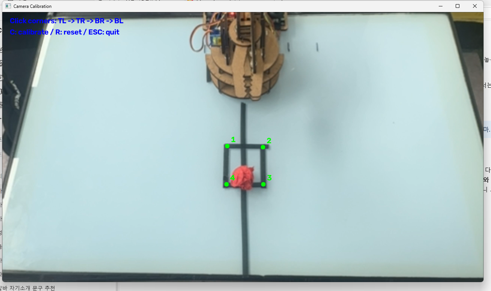
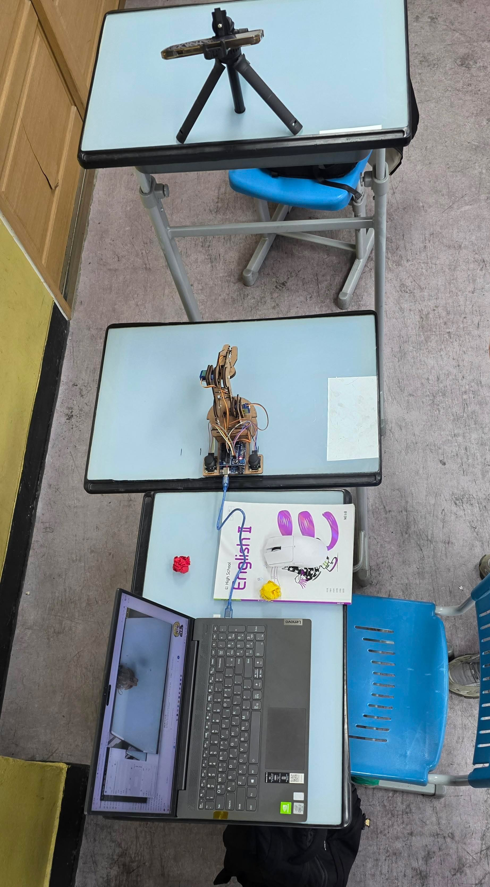

# Arduino-Color-Sorting-Robot

**컴퓨터 비전 기반 색상 인식 및 아두이노 로봇팔 자동 분류 시스템**

Python과 OpenCV를 이용해 카메라 영상에서 빨간색과 노란색 물체를 인식하고, Arduino UNO R4 WiFi로 제어하는 로봇팔을 통해 물체를 좌우로 자동 분류하는 프로젝트입니다.

## 1. 프로젝트 소개

카메라로 물체의 색상과 위치를 인식한 뒤, 인식 결과를 Arduino에 전달하여 로봇팔이 물체를 자동으로 분류하도록 구현했습니다.

- 카메라 영상 실시간 수신
- 작업 영역 좌표 보정
- OpenCV를 활용한 색상 인식
- Python과 Arduino 간 시리얼 통신
- 색상에 따른 좌우 자동 분류
- 분류 완료 후 다음 실험을 위한 팝업 표시

## 2. 사용 기술 및 장비

### 하드웨어
- Arduino UNO R4 WiFi
- Arduino 로봇팔 키트
- iPhone 카메라
- Windows 노트북

### 소프트웨어
① Python

프로그래밍 언어로, 카메라 영상 처리와 색상 인식, Arduino와의 통신을 담당합니다. 이번 프로젝트에서는 전체적인 프로그램의 흐름을 제어하고 인식 결과에 따라 로봇팔에 명령을 전달하는 역할을 합니다.

② OpenCV (Open Source Computer Vision Library)

영상 및 이미지 처리를 위한 오픈소스 라이브러리입니다. 카메라로 입력받은 영상에서 물체의 색상을 구분하고, 물체의 위치를 계산하는 데 사용했습니다.

③ NumPy

Python에서 배열과 행렬을 효율적으로 처리하기 위한 라이브러리입니다. OpenCV에서 사용하는 이미지 데이터를 배열 형태로 다루고 색상 영역을 분석하는 데 활용했습니다.

④ PySerial

Python과 Arduino 사이의 시리얼 통신을 가능하게 하는 라이브러리입니다. 인식한 물체의 색상에 따라 R 또는 Y 문자를 Arduino에 전달하고, 동작이 완료되면 Arduino로부터 DONE 메시지를 수신합니다.

⑤ HSV 색상 공간

색상을 색상(Hue), 채도(Saturation), 명도(Value) 세 가지 요소로 표현하는 방식입니다. RGB 색상 공간보다 색상 자체를 구분하기 편리하여 빨간색과 노란색을 인식하는 데 활용했습니다.

⑥ 윤곽선 검출(Contour Detection)

이미지에서 서로 연결된 객체의 경계선을 찾아내는 영상 처리 기술입니다. 색상 마스크에서 물체의 윤곽선을 검출하고, 물체의 중심 좌표를 계산하는 데 사용했습니다.

⑦ 원근 변환(Perspective Transformation)

카메라가 비스듬한 각도에서 촬영한 작업 영역을 정면에서 바라본 것처럼 변환하는 기술입니다. 화면의 네 모서리를 지정하여 작업 영역을 보정하고 물체의 위치를 보다 일관된 좌표로 계산할 수 있도록 했습니다.

⑧ 시리얼 통신(Serial Communication)

데이터를 한 번에 한 비트씩 순서대로 전송하는 통신 방식입니다. Python 프로그램과 Arduino를 USB로 연결하여 색상 인식 결과와 동작 완료 정보를 주고받는 데 사용했습니다.

⑨ 서보모터(Servo Motor)

입력된 각도 명령에 따라 회전 위치를 제어할 수 있는 모터입니다. Arduino에서 서보모터의 각도를 조절하여 로봇팔의 바닥 회전과 집게 동작을 제어했습니다.

## 3. 작동 방식

1.카메라로 작업 영역을 촬영합니다.

2.화면의 네 모서리를 지정하여 작업 영역을 보정합니다.

3.HSV 색상 공간을 이용해 빨간색과 노란색 물체를 구분합니다.

4.윤곽선 검출을 통해 물체의 중심 좌표를 계산합니다.

5.인식한 색상에 따라 Arduino에 명령을 전달합니다.

6.로봇팔이 물체를 좌우로 분류합니다.

7.동작이 완료되면 팝업창을 표시하여 다음 실험을 준비합니다.

## 4. 색상별 분류 방식

| 인식 색상 | Arduino 명령 | 동작 |
|---|---|---|
| 빨간색 | R | 오른쪽 분류 |
| 노란색 | Y | 왼쪽 분류 |

## 5. 하드웨어 제어

| 부품 | Arduino 핀 |
|---|---|
| 바닥 회전 서보모터 | D4 |
| 집게 서보모터 | D7 |

로봇팔의 모든 관절을 사용하는 대신 바닥 회전 모터와 집게 모터를 활용하여 좌우 분류 기능을 구현했습니다.

## 6. 프로젝트 실행 화면

### 카메라 좌표 보정



### 실제 실험 환경



### 자동 분류 시연 영상

[시연 영상 보기](videos/sorting_demo.mp4)

## 7. 실행 방법

### ① Python 라이브러리 설치

```bash
pip install opencv-python numpy pyserial
```

### ② Arduino 코드 업로드

Arduino IDE에서 `color_sorting_robot.ino` 파일을 열고 Arduino UNO R4 WiFi에 업로드합니다.

### ③ Python 코드 실행

Arduino의 시리얼 포트와 카메라 연결 상태를 확인한 후 다음 명령어를 실행합니다.

```bash
python coordinate_calibration.py
```

## 8. 문제 해결 및 개선 과정

프로젝트 진행 중 arm1 모터가 정상적으로 작동하지 않는 문제가 발생했습니다. arm2와 집게 모터만으로 물체를 들어 올리려고 했을 때 무게를 지탱하지 못하는 문제도 확인했습니다.

이를 해결하기 위해 arm1과 arm2를 사용하지 않고 바닥 회전 모터와 집게 모터만으로 좌우 분류가 가능하도록 제어 방식을 변경했습니다.

또한 물체를 놓은 뒤 다음 실험을 준비할 시간을 확보하기 위해 분류 완료 후 팝업창을 표시하는 기능을 추가했습니다.

## 9. 향후 개선 방향

- 로봇팔 관절 모터 작동 문제 해결
- 더 다양한 색상 인식 기능 추가
- 물체 위치에 따른 정밀한 제어
- 여러 물체의 연속 자동 분류 구현
